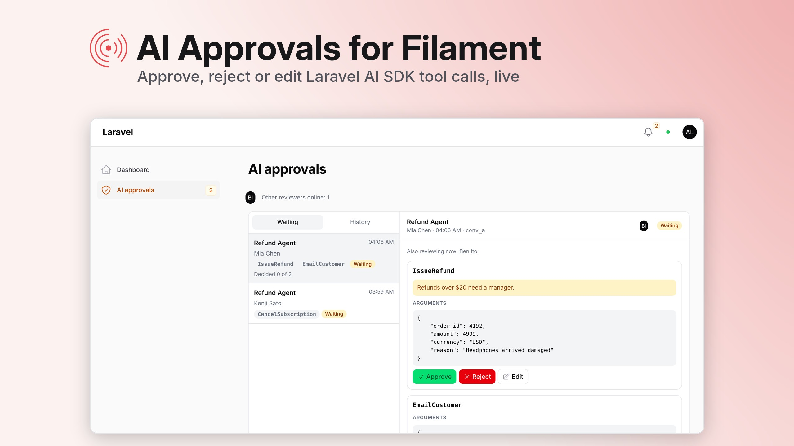

# hibira-io/filament-approvals



[](https://github.com/hibira-io/filament-approvals/actions/workflows/ci.yml)

A live inbox in your [Filament](https://filamentphp.com) panel for the
[Laravel AI SDK](https://github.com/laravel/ai)'s tool approvals, on
[Hibira](https://hibira.io).

When an agent wants to run a tool that needs a person's OK, such as a refund
over $20 or deleting an account, the SDK pauses the turn. This package puts
that pause in front of your team, lets them approve, reject or edit it, and
carries the agent on with their decision.

- **Approvals inbox** in your panel, live over Hibira: new requests appear
  the moment the agent pauses, with a badge and a notification anywhere in
  the panel.
- **Approve, reject with a reason, or edit the arguments** of each tool call.
  The reason goes back to the model as the tool's result.
- **See who else is looking**: reviewers online, and who has the same request
  open, so two people don't decide the same refund.
- **Phone and browser notifications** with Hibira Push, only to approvers who
  don't have the panel open. They name the agent and the tool; the
  arguments stay in the panel.
- **The agent carries on by itself** on your queue once every call is
  decided, and streams the rest of its answer to your user when you use
  [hibira-io/laravel](https://github.com/hibira-io/laravel)'s AI bridge.
- **Safe with more than one reviewer**: a turn is resumed once, decisions
  can't change after it is sent, and a turn answered somewhere else (such as
  in your app's own chat) isn't resumed again.
- In English, 繁體中文, 简体中文, 日本語, 한국어, ไทย and Tiếng Việt.

Supports Filament 3.3, 4 and 5 on Laravel 12 and 13 (the Laravel AI SDK
needs PHP 8.3 and Laravel 12+). Requests are stored in your own database;
Hibira only delivers them live.

## Install

```sh
composer require hibira-io/filament-approvals
php artisan hibira:install
php artisan migrate
```

`hibira:install` (from [hibira-io/laravel](https://github.com/hibira-io/laravel))
adds the `HIBIRA_*` settings to `.env`. Copy the app ID, key and secret from
your app page on [hibira.io/portal](https://hibira.io/portal) (the free plan
needs no card), and check them with `php artisan hibira:check`.

Add both plugins to your panel. `HibiraPlugin` from
[hibira-io/filament](https://github.com/hibira-io/filament) connects the
panel to Hibira; `HibiraApprovalsPlugin` adds the inbox.

```php
use App\Models\User;
use Hibira\Filament\HibiraPlugin;
use Hibira\FilamentApprovals\HibiraApprovalsPlugin;

public function panel(Panel $panel): Panel
{
    return $panel
        // ...
        ->plugins([
            HibiraPlugin::make(),
            HibiraApprovalsPlugin::make()
                ->approvers(fn () => User::where('is_admin', true)->get()),
        ]);
}
```

Run a queue worker (`php artisan queue:work`): decided turns resume there.

## Make a tool ask first

This is the Laravel AI SDK's own feature; nothing here is specific to this
package. Implement `Approvable` on the tool:

```php
use Laravel\Ai\Approvals\Approval;
use Laravel\Ai\Concerns\InteractsWithApprovals;
use Laravel\Ai\Contracts\Approvable;
use Laravel\Ai\Contracts\Tool;

class IssueRefund implements Approvable, Tool
{
    use InteractsWithApprovals;

    protected function needsApproval(Request $request): Approval|bool
    {
        return $request['amount'] <= 2000
            ? false
            : Approval::required('Refunds over $20 need a manager.');
    }

    // ...
}
```

The agent must remember conversations (`RemembersConversations`), so the
paused turn can be resumed. Prompt it as usual, with `prompt()`, `stream()`,
`queue()` or `broadcast()`. When it pauses, the request shows up in
**AI approvals** in your panel. Tell your user it is waiting: the response's
`pendingApprovals`, or the `tool_approval_request` stream event.

## Options

```php
HibiraApprovalsPlugin::make()
    // Who may decide. Gets the request too, so you can split by tool.
    ->authorize(fn (User $user, ?ApprovalRequest $request) => $user->can('approve-ai-actions'))

    // Who to notify. Push goes to their Hibira Push user id (their key).
    ->approvers(fn (ApprovalRequest $request) => User::role('manager')->get())

    // Hibira Push to approvers who don't have the panel open (on by default
    // when HIBIRA_PUSH_* is set). Pass evenWhenOnline: true to push everyone.
    ->pushNotifications(true, evenWhenOnline: false)

    // Also keep a Filament database notification (needs databaseNotifications()).
    ->databaseNotifications()

    // The notification anywhere in the panel. On by default.
    ->toasts()

    ->navigationGroup('AI')
    ->navigationSort(5);
```

Approvers' devices register for Hibira Push with the
[web](https://github.com/hibira-io/hibira-push-web),
[iOS](https://github.com/hibira-io/hibira-push-ios) or
[Android](https://github.com/hibira-io/hibira-push-android) SDK and
`setUserId`; hibira-io/laravel serves their user tokens when you set
`HIBIRA_PUSH_TOKEN_ROUTE`.

Only some agents? Publish the config and list them:

```sh
php artisan vendor:publish --tag=hibira-approvals-config
```

```php
'agents' => [App\Ai\Agents\SupportAgent::class],
```

## How the agent is resumed

When every paused call has a decision and a reviewer sends them, a queued
job runs, on `hibira-approvals.queue` if you set one:

```php
app($agentClass)->continue($conversationId, as: $user)->prompt($decisions);
```

With hibira-io/laravel's AI bridge installed, it streams the rest of the
turn to the user's channel instead, with `broadcastNow()`, so your chat UI
picks the answer up live. Choose another channel, or none:

```php
use Hibira\FilamentApprovals\HibiraApprovals;

HibiraApprovals::broadcastUsing(fn (ApprovalRequest $request, ?object $user) => new PrivateChannel("support.{$request->conversation_id}"));
```

If your agent needs constructor arguments, or you resume it some other way,
take over in a service provider's `boot()`:

```php
use Laravel\Ai\Approvals\Decisions;

HibiraApprovals::resumeUsing(function (ApprovalRequest $request, Decisions $decisions, ?object $user) {
    SupportAgent::for($request->user())->continue($request->conversation_id, as: $user)->prompt($decisions);
});
```

The job runs once. If the agent fails after an approved tool already ran,
running the same decisions again could run it twice, so the request shows
as failed with the error, and a reviewer chooses **Try again**. Before
resuming, the job checks the conversation still waits on those calls.

## Channels

| Channel | Type | For |
| --- | --- | --- |
| `private-hibira-approvals.{panel}.inbox` | private | new and decided requests |
| `presence-hibira-approvals.{panel}.reviewers` | presence | reviewers with the panel open; used to skip their push |
| `presence-hibira-approvals.{panel}.request.{id}` | presence | who has a request open |

All three are authorized for users who can use the panel and pass
`authorize()`. Events carry the request id, agent and tool names only; the
browser fetches the arguments through the panel.

## Translations

```sh
php artisan vendor:publish --tag=hibira-approvals-translations
```

## License

MIT. See [LICENSE](LICENSE).
